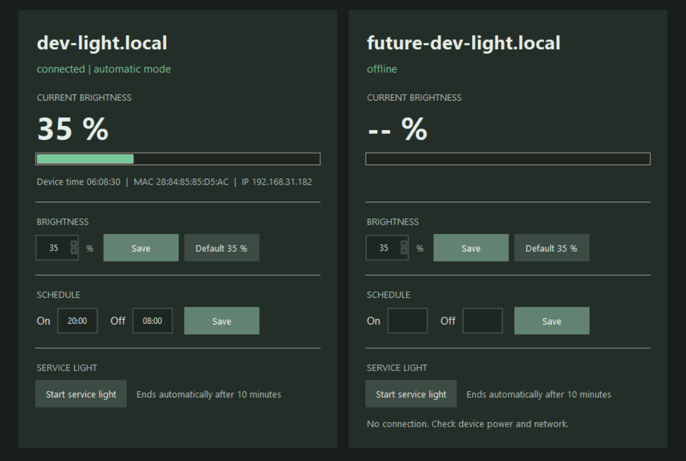

# FNC Power

Power supply and lighting control for the **FNC system**, with a total power capacity of up to **200W**. FNC Power provides the onboard supply voltage for sensors and climate control, a dimmable PWM power supply for system lighting through an external LED dimmer, and configurable lighting intervals.

The system communicates over Wi-Fi and can be expanded with additional devices without a fixed device-count limit in the system design. Each controller operates its own lighting schedule and supports adjustable brightness, local push-button control and authenticated OTA updates. The current desktop viewer displays two devices at a time.

The current implementation uses a **KinCony DM4 (ESP32-S3, N16R8)**, built with PlatformIO. Its 0–10V output controls the external LED dimmer, which supplies the PWM-dimmed lighting power.

## Wiring diagram


[Open full-size diagram](docs/wiring.svg) · [Wiring details and terminal table](docs/wiring.md)

## Desktop viewer



Install dependencies and start **FNC Light**:

```powershell
pip install -r tools/viewer-requirements.txt
python tools/light_viewer.py
```

Create a desktop shortcut with the lamp icon:

```powershell
powershell -ExecutionPolicy Bypass -File tools/install_viewer_shortcut.ps1
```

The viewer discovers controllers through `_fnc-light._tcp.local.` every 30 seconds. Two fixed columns show device names, connection state, operating mode, output brightness, local time, MAC and IP address. Device assignments are kept in the Git-excluded `viewer.devices.local.json`.

- Click the `.local` name to rename a device. Enter or leaving the field saves; Escape cancels. The suffix stays fixed. Use a unique name with up to 63 lowercase letters, digits and hyphens.
- **BRIGHTNESS** sets automatic brightness; **Default** restores the firmware default of 35%.
- **SCHEDULE** saves on/off times together in HH:MM format. Equal times disable the schedule.
- **SERVICE LIGHT** starts a ten-minute override and can end it early.

Names, brightness and schedule settings survive restarts in NVS. Renaming updates mDNS without rebooting. Writes use the OTA password from `network.local.json`; it is never displayed. The viewer uses the fnc-fogger dark palette.

Each new controller receives a unique `<hostname>-<MAC>.local` name. mDNS requires a shared local multicast network or a reflector between VLANs. If Windows blocks multicast responses, discovery also probes the private /24 network using unicast mDNS.

## Configuration

Build defaults are defined in [`UserConfig.h`](UserConfig.h):

```cpp
constexpr int brightnessPercent = 35;
constexpr int serviceBrightnessPercent = 100;
constexpr int maxBrightnessPercent = 100;
constexpr int onHour = 20;
constexpr int onMinute = 0;
constexpr int offHour = 8;
constexpr int offMinute = 0;
```

Brightness values are absolute percentages of the 0–10V range. A 17% target remains 17% with a 70% maximum. Targets above the maximum are clamped in every mode, including service and button feedback. A zero maximum keeps the output at 0V. Invalid percentages or times cause a build error.

Measurements on the previous CONTROLLINO installation:

| Brightness | Minimum illuminance inside the box |
| --- | --- |
| 17% | 44 lux |
| 30% | 260 lux |
| 35% | 369 lux |
| 40% | 510 lux |
| 50% | 800 lux |

The 35% default met the 300 lux target there and corresponds to approximately 3.5V. Recheck voltage and illuminance on the DM4. The measurements are also recorded in `UserConfig.h`.

Times use the local RTC clock with minute resolution. Daytime and overnight windows are supported. Equal on/off times disable the schedule; service remains available. Automatic transitions take 60 seconds. Changing build defaults requires rebuilding and uploading. The viewer can persistently override automatic brightness and schedule times.

## Operating behavior

| Action / time | Output with default settings |
| --- | --- |
| From 20:00 | Ramp from 0% to 35% over 60 seconds, then hold 35% |
| From 08:00 | Ramp from 35% to 0% over 60 seconds, then remain off |
| Short press, on release | Ramp to 100% over five seconds; return to the schedule after ten minutes |
| Another short press during service | End service immediately and return to the current automatic target |
| Long press, 1.25 seconds | Disable automatic mode persistently; jump to maximum, then fade to 0% over five seconds |
| Long press while disabled, 0.75 seconds | Enable automatic mode; ramp to maximum over five seconds, blink three times, then return to the automatic target over 0.4 seconds |

The service timer includes its initial ramp. A short press cancels service even during that ramp; cancellation and expiry return directly to the scheduled target. Service works without valid time and while automatic mode is disabled. It does not change the saved mode; a disabled controller returns to 0% afterwards. A long press ends service.

Automatic ramps continue in the background during overrides. Returning to automatic mode uses the current point on the scheduled ramp. Enable feedback holds maximum for 300ms, then blinks three times with 300ms off and 300ms on. Disable feedback has no blinks. Preparatory/final transitions take 0.4 seconds where needed; an already reached starting value needs no transition. Another long press starts from the last output; disabling jumps straight to maximum.

The button is debounced for 30ms. Hold times start after debounce; holding triggers only once, and release after a long press does not trigger a short press. A short press interrupts mode feedback and starts service. Ramps and service timing do not block the main loop.

The saved disabled mode survives restarts. A new device starts in automatic mode. Service and feedback ramps do not resume after reboot. Startup or clock recovery applies the current scheduled target immediately. Setting the clock across a schedule boundary starts a 60-second transition.

Output and ramp calculations use 12-bit resolution (0–4095). A 0–35% ramp contains 1,433 steps, averaging approximately 42ms between steps. The theoretical voltage increment is 2.44mV; physical accuracy depends on the output stage.

## Wiring

[Wiring details and terminal table](docs/wiring.md)

Regenerate the SVG with `python tools/build_wiring_diagram.py` after editing the generator or replacing `docs/wiring_example.png`. The photo is embedded in the SVG.

- Supply the DM4 with **12–24V DC**; the existing 24V supply can be used.
- Connect **digital IN4 → normally open push button → input GND**. Do not apply external voltage. Remove or reroute any previous +24V button wire. No extra pull-up is required. Do not use analog inputs A1–A4 or spare GPIOs.
- Connect **0–10V OUT4 / DAC D** to the dimmer control input, and output GND to signal ground where permitted by the dimmer manufacturer.
- Outputs 1–3 are set to zero at startup and remain unused.
- Connect RJ45 for Ethernet access, or configure Wi-Fi. No SD card is required.

The dimmer must switch off at 0V. A 1–10V current-sink interface is not automatically compatible with an active voltage output. The DAC uses its internal reference and gain of 1, following KinCony's ESPHome example.

## Network setup

Copy `network.example.json` to **`network.local.json`**, or retain your existing local configuration. The local file is excluded from Git.

| Setting | Purpose |
| --- | --- |
| `ethernet` | Defaults to `true`; DHCP assigns the address |
| `hostname` | Defaults to `fnc-power`; new devices receive a unique suffix |
| `wifi_ssid`, `wifi_password` | Optional 2.4GHz Wi-Fi credentials when no credentials header exists |
| `ota_password` | Your password, at least 12 characters; empty disables OTA |

Alternatively, define `WIFI_SSID` and `WIFI_PASSWORD` in `wifi-credentials.h`. The build checks the project root, then `../wifi-credentials.h`, then the JSON fields. See [wifi-credentials.example.h](wifi-credentials.example.h). The real header is excluded from Git.

Without local JSON, the example configuration enables Ethernet and disables OTA; an existing Wi-Fi header still applies. Credentials are embedded during the build, so changes need another upload. Do not publish credentials or firmware binaries. OTA is intended for a trusted local network without Internet port forwarding; transfers are not TLS-encrypted.

Network connection attempts do not block local schedule or button control. The serial monitor reports `LAN IP ...`, `WiFi IP ...` and `OTA ready`; the router's DHCP list also shows addresses. The OLED, Tuya, cloud services, Home Assistant, SD card and analog inputs are not used.

## Build and first USB upload

Install PlatformIO in VS Code. The pinned pioarduino platform uses Arduino-ESP32 3.3.12 for W5500 Ethernet support. Git must be on PATH. The first build downloads the toolchain. The board has 16MB flash and 8MB PSRAM; the partition table provides two 6MiB OTA firmware slots and separate NVS storage.

```powershell
$env:PYTHONUTF8 = "1"
$env:PYTHONIOENCODING = "utf-8"
pio run -e kincony_dm4
pio device list
pio run -e kincony_dm4 -t upload --upload-port COM5
pio device monitor -e kincony_dm4 --port COM5
```

Replace `COM5` with the actual port, or use PlatformIO's VS Code tasks. UTF-8 settings avoid Windows upload-progress encoding errors. If `pio` is unavailable, use `& "$env:USERPROFILE/.platformio/penv/Scripts/platformio.exe"` instead.

Connect USB-C with a data cable and power the DM4 externally. If automatic bootloader entry fails, hold ESP32 download, briefly press ESP32 reset, release download and retry. Do not use the Tuya button. The firmware uses native USB CDC for serial monitoring; the COM port may change after the first upload. UART0 GPIO43/44 are reserved for Ethernet.

The first upload must use USB to install the firmware and OTA partition layout, replacing the factory firmware. Building alone does not upload. Both controllers use the same firmware and partitioning.

Keep the dimmer disconnected for the first test: existing DAC EEPROM settings can restore an old output before firmware startup. The firmware zeros all outputs at startup and writes dimming values only to volatile DAC registers. A glitch-free output during power-up/reset is not guaranteed.

## OTA updates

After the first USB upload, use the device IP or current mDNS name:

```powershell
pio run -e kincony_dm4_ota -t upload --upload-port device-name.local
```

The uploader reads the password from `network.local.json`. ArduinoOTA uses UDP 3232 and a TCP return connection to the upload PC. Allow local access for the uploader when prompted. Existing inbound blocking rules for PlatformIO's `python.exe` can block the return connection: the DM4 may report `OTA started`, then `ERR OTA 2`, while the uploader reports an authentication error. Check firewall rules in that case. `pio run -e kincony_dm4_ota` builds without uploading.

During an authenticated update, OUT4 is set to zero and button/ramp processing pauses. Success reboots into the current schedule or saved disabled mode. Service and feedback do not resume. A transfer failure restores local control in the existing firmware; a DAC error while switching off aborts the update. Incomplete firmware is not selected as the boot partition. Automatic rollback for a fully transferred but faulty application is not configured; USB is the recovery method.

Install password changes over USB first: normal OTA requires the local password to match the running firmware. Change partitioning only over USB. There is no browser firmware-upload page. Both installed controllers have passed OTA upload and reboot tests.

## Local status and API

`http://<device-IP>/` displays local time, RTC status, mode, automatic-mode state, schedule and the 12-bit OUT4 target. It refreshes every five seconds. Voltage is calculated from the target, not measured; write failures can leave the physical output at another value.

The page and `GET /api/status` are readable without authentication on the local network. The page is unavailable during OTA. An active schedule with automatic mode disabled means the saved off mode overrides it. The page reports the active time source and whether NTP has set the RTC during this run.

`POST /api/control` requires an empty body (`Content-Length: 0`), `X-OTA-Password`, `X-Command` and `X-Value`:

| Command | Value |
| --- | --- |
| `name` | DNS name |
| `brightness` | Percentage |
| `reset` | Restore default brightness |
| `service` | `on` or `off` |
| `schedule` | `HH:MM,HH:MM` (on, off) |

Schedule times are saved together as one NVS value. HTTP control and clock-setting requests are unencrypted, including the password header; use only on a trusted local network.

## Setting the clock

Transfer the PC's local time over Wi-Fi or Ethernet without uploading firmware:

```powershell
python tools/set_clock_network.py device-name.local
```

The tool loads the password from `network.local.json`, posts to `/time` and waits for verified RTC write confirmation.

The DS3231 stores **local time**. Boot does not reset it or replace it with build time. If invalid, the firmware requests NTP from `ch.pool.ntp.org`, `pool.ntp.org` or `time.cloudflare.com` and converts the response to Swiss local time (CET/CEST). A network connection alone does not guarantee an NTP response. A valid RTC takes priority and is not periodically overwritten.

Without a backup battery, initial synchronization repeats after each complete power loss. With a suitable battery, the RTC keeps running. A valid RTC does not automatically adjust for daylight saving time; set it from the PC after seasonal changes. Initial NTP synchronization applies the offset valid at that moment.

Without valid time, automatic mode holds its normal brightness even without networking. When time becomes valid, the current schedule applies immediately. Service and deliberately saved disabled mode take priority. If the RTC write fails after NTP synchronization, the ESP32 clock is used and the RTC write is retried every 30 seconds.

RTC checks detect I²C errors, oscillator stop, a disabled battery oscillator and invalid calendar values. Supported years: 2000–2099. OTA needs no valid clock.

For USB clock setting, close the serial monitor and run:

```powershell
& "$env:USERPROFILE/.platformio/penv/Scripts/python.exe" tools/set_clock.py COM5
```

Alternatively, use 115200 baud and LF line endings in the serial monitor:

```text
TIME 2026-11-18 19:55:00
TIME?
```

Use the actual local date/time. `OK TIME` confirms the update. Fit a suitable backup battery according to the board specification to retain time across outages.

## Structure and tests

| File | Responsibility |
| --- | --- |
| `lib/Control/Control.h` | Hardware-independent lighting/button logic and 12-bit brightness |
| `UserConfig.h` | Default targets, maximum and schedule |
| `src/Dm4Hardware.cpp` | MCP4728 DAC and PCF8574 button input |
| `src/I2cBus.cpp` | Checked I²C transactions; 100kHz, 20ms timeout |
| `src/RtcClock.cpp`, `include/RtcRegisters.h` | DS3231 access and calendar conversion |
| `include/ModeStore.h` | Persistent operating mode in NVS |
| `src/NetworkServices.cpp` | Ethernet, Wi-Fi and ArduinoOTA |
| `src/NetworkClock.cpp` | Nonblocking initial NTP synchronization, Swiss time zone |
| `src/StatusPage.cpp` | Local HTTP status/control with bounded request processing |
| `src/SerialClock.cpp` | Bounded, nonblocking serial parser |
| `src/main.cpp` | Module integration and error handling |

```powershell
python tools/test_control.py
pio run -e kincony_dm4
pio run -e kincony_dm4_ota
```

Host tests require Python and LLVM/Clang or GCC. They exercise the actual C++ implementation: schedules, service, modes, ramps, debounce, long presses, `millis()` overflow, 12-bit intermediate values and DS3231 calendar/12-hour/24-hour decoding. Builds do not replace hardware testing.

Failed hardware initialization is retried every second. A button-read error discards debounce state; a valid released state is needed before accepting presses again, including a button held during boot. DAC write failures are reported and retried. Bus/hardware failures can leave the output at its last voltage. Network failures do not interrupt local control.

## Hardware commissioning

1. Start without the dimmer. Check `DM4 I/O OK` and measure OUT4.
2. Set the clock; verify about 0V by day and 3.5V at night. A short press should reach about 10V over five seconds.
3. Verify outputs 1–3 are at 0V before connecting a compatible dimmer.
4. Set 07:59:55 and 19:59:55 and observe both 60-second transitions.
5. Test service by day/night, both long presses and reboot with automatic mode disabled.
6. With a backup battery fitted, briefly disconnect power and verify the clock after restart.
7. Disconnect the network and verify local control. Reconnect and check IP connectivity/OTA.
8. Test OTA and reboot, then verify the clock and saved settings.

## Archived CONTROLLINO version

Tag **`controllino-stable`**, commit **`0a4dfc6`** (`Save stable Controllino firmware`), preserves the version before the DM4 port. For a future backport, reuse its hardware integration and adapt it to current control logic. The active build targets DM4.

## Hardware references

- [KinCony DM4 hardware and power](https://www.kincony.com/esp32s3-dimmer-module-dm4-4ch-dimmer.html)
- [DM4 pins and I²C addresses](https://www.kincony.com/forum/showthread.php?tid=8993)
- [DM4 inputs, DAC reference and Ethernet configuration](https://www.kincony.com/forum/showthread.php?tid=8994)
- [Microchip MCP4728 12-bit DAC](https://www.microchip.com/en-us/product/mcp4728)
- [Analog Devices DS3231 datasheet](https://www.analog.com/media/en/technical-documentation/data-sheets/ds3231.pdf)
